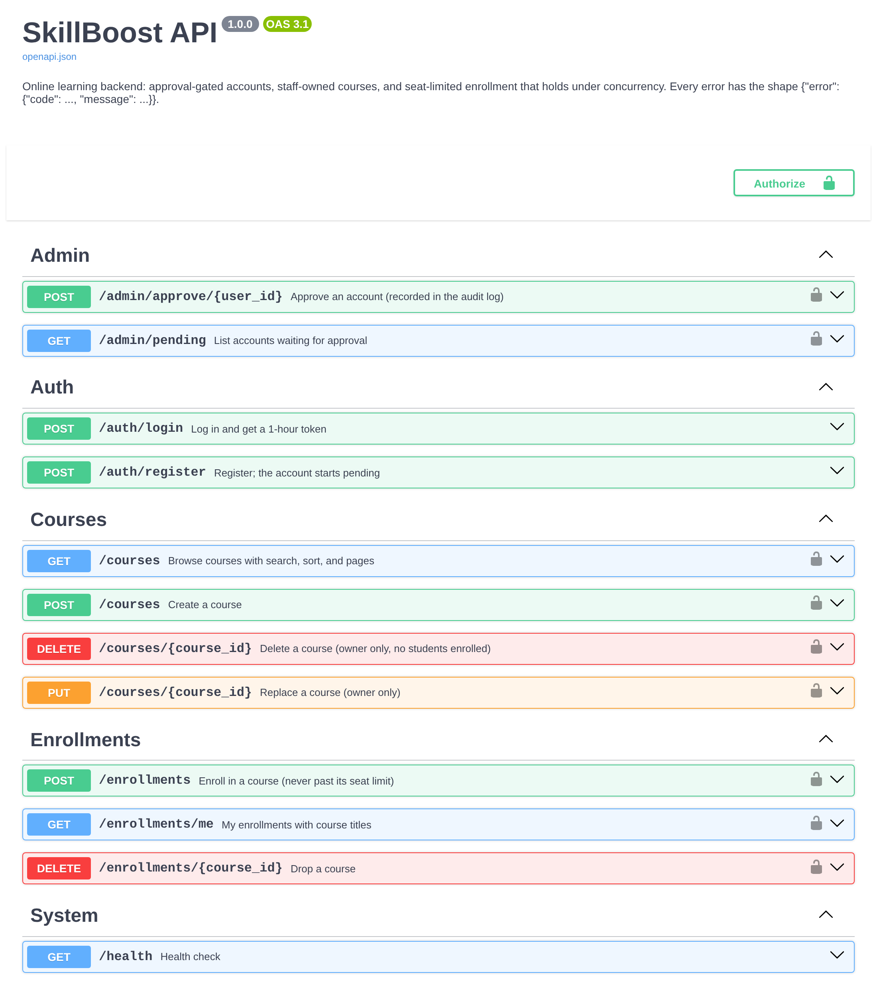
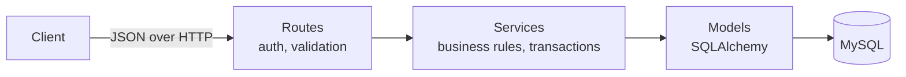
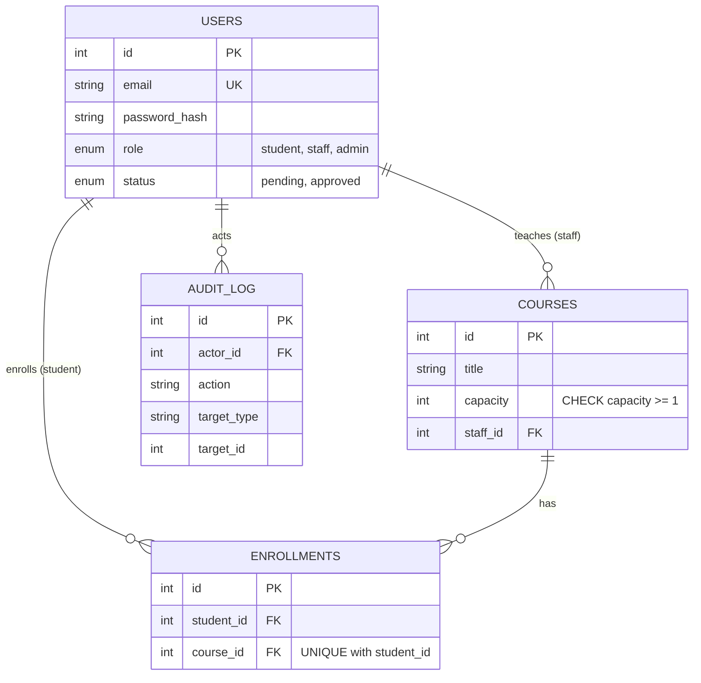

# SkillBoost

 

A Flask and MySQL backend for an online learning platform: staff publish courses, students enroll, and an admin approves who gets access. Course seat limits hold even when many students enroll at the same moment.

**Highlights**

- **Race-safe enrollment, proved by a test.** Ten students enrolling at the same instant for three seats: exactly three succeed, in 10 of 10 runs. The test also caught a real bug in the original design ([details](#capacity-safe-enrollment)).
- **225 tests against a real MySQL**, run in CI on every pull request, with 98% coverage and a gate that fails below 80%.
- **Typed and checked.** Every function in `app/` has type hints, enforced by ruff and verified by mypy in CI.
- **Production basics.** One JSON error format, JSON request logs with request IDs, login rate limiting, an audit log, database migrations, and Docker Compose.
- **Built the way a team builds.** Five sprints, one issue and one pull request per task (26 merged), a project board, and a written retro after every sprint.



## Quick start with Docker

```
docker compose up --build
docker compose exec app flask --app app seed
```

Open http://localhost:8000/docs. This starts the API and its own MySQL; the database tables are built automatically.

## Run it without Docker

Needs Python 3.12 and a MySQL 8 database. Copy `.env.example` to `.env` and fill in your database URL and a JWT secret.

```
pip install -r requirements.txt
flask --app app db upgrade      # builds every table from the migration
flask --app app create-admin    # creates the first admin account
flask --app app seed            # demo users, courses, and enrollments (safe to run twice)
flask --app app run --debug
```

Open http://127.0.0.1:5000/docs for interactive API docs. Log in with `POST /auth/login`, then click **Authorize** and paste the `access_token`.

All demo accounts use the password `DemoPass123!`:

| Role | Email |
|---|---|
| Admin | admin@skillboost-demo.com |
| Staff | meena@skillboost-demo.com, arjun@skillboost-demo.com |
| Student | ravi@skillboost-demo.com (also priya, karthik, divya, sanjay) |
| Student waiting for approval | anu@skillboost-demo.com |

"System Design Basics" is already full, so enrolling in it shows the `409 COURSE_FULL` response.

## API

| Method | Path | Who | Success | Errors |
|---|---|---|---|---|
| GET | /health | Public | 200 | none |
| POST | /auth/register | Public | 201 | 400, 409 |
| POST | /auth/login | Public | 200 with token | 400, 401, 403, 429 |
| GET | /admin/pending | Admin | 200 | 401, 403 |
| POST | `/admin/approve/<id>` | Admin | 200 | 401, 403, 404 |
| GET | /courses | Any approved user | 200, paginated | 400, 401 |
| POST | /courses | Staff | 201 | 400, 401, 403 |
| PUT | `/courses/<id>` | Staff, owner only | 200 | 400, 401, 403, 404 |
| DELETE | `/courses/<id>` | Staff, owner only | 204 | 401, 403, 404, 409 |
| POST | /enrollments | Student | 201 | 400, 401, 403, 404, 409 |
| DELETE | `/enrollments/<course_id>` | Student | 204 | 401, 403, 404 |
| GET | /enrollments/me | Student | 200 | 401, 403 |

`GET /courses` query: `page` (default 1), `per_page` (default 20, max 100), `q` (title contains), `sort` (`title`, `-title`, `created_at`, `-created_at`; default `-created_at`).

Every error, whatever caused it, has the same shape:

```json
{ "error": { "code": "COURSE_FULL", "message": "This course has no seats left." } }
```

New accounts start as `pending` and cannot log in until an admin approves them. Admins are created only from the command line, never through the API. The full specification is served at `/openapi.json`, and a test checks that it lists exactly the routes the app serves.

## Architecture

Calls go one way: routes check the request, services apply the business rules, models talk to MySQL.



| Folder or file | What lives there |
|---|---|
| `app/routes/` | One blueprint per area: auth, admin, courses, enrollments, health, docs |
| `app/services/` | Business rules; no Flask request objects, so they are testable without HTTP |
| `app/models.py` | Four tables: users, courses, enrollments, audit_log |
| `app/auth.py` | JWT helpers and the `token_required` and `role_required` decorators |
| `app/schemas.py` | Pydantic schemas that validate every request body |
| `migrations/` | One initial migration that builds the whole schema |
| `tests/` | Unit, integration, and end-to-end tests |

## Data model



The database enforces the key rules itself, as a second layer behind the code: a UNIQUE (student, course) pair, a CHECK on capacity, and foreign keys that refuse to delete a course with students enrolled.

## Capacity-safe enrollment

**Problem.** A course has a fixed number of seats. If many students enroll at the same moment, a naive "count the seats, then insert" lets several of them see the same free seat, and the course is oversold.

**Approach.** Enrolling runs in one transaction that:
1. locks the course row with `SELECT ... FOR UPDATE`, so requests for the same course take turns;
2. checks for a duplicate and counts taken seats with locking reads, which always see the latest committed rows (a plain read under MySQL's default REPEATABLE READ would use a stale snapshot taken before the request waited for the lock);
3. inserts the enrollment and commits, which releases the lock.

The UNIQUE (student, course) constraint is a second safety net for a double-click.

**Proof.** `test_us6b_ten_students_racing_for_three_seats` sends 10 enroll requests at the same instant, each on its own connection, for a course with 3 seats.

| Version | Students enrolled (3 seats) |
|---|---|
| No locks | 9, then 6: oversold |
| Course row locked, plain seat count | 10: oversold every run |
| Course row locked and locking seat count (final) | 3, in 10 of 10 runs |

The middle row was the original design. Locking the course row alone looked correct, but the race test showed it still oversold, which is how the stale-snapshot problem was found.

## Query performance

`flask --app app explain-queries` prints MySQL's EXPLAIN plan for the key queries, using the same query functions as the app. Measured on MariaDB 10.11 with 60 users, 30 courses, and 300 enrollments:

| Query | Table | Access type | Index used | Rows examined | Extra |
|---|---|---|---|---|---|
| Login: find user by email | users | const | email | 1 | |
| Enroll: duplicate check | enrollments | const | uq_enrollments_student_course | 1 | |
| Enroll: seat count | enrollments | ref | ix_enrollments_course_id | 30 | Using index |
| My enrollments (with course titles) | enrollments | ref | uq_enrollments_student_course | 10 | Using where; Using filesort |
| My enrollments (with course titles) | courses | eq_ref | PRIMARY | 1 | |
| Course list, newest first | courses | ALL | none | 30 | Using filesort |
| Course list, title search | courses | ALL | none | 30 | Using where; Using filesort |

- Every per-request lookup uses an index: login and the duplicate check read one row through a unique index (`const`); the seat count reads only the course_id index (`Using index`); my-enrollments uses the (student_id, course_id) index and joins courses by primary key.
- The course list reads the whole table and sorts it (`ALL`, `Using filesort`), which is fine at this size. Title search uses `LIKE '%...%'`, whose leading wildcard can never use a normal index. At scale: a FULLTEXT index for search, and an index on (created_at, id) for the newest-first page.
- Plans depend on data size: on a tiny development database (3 courses), MySQL 8 chose a skip scan on the (student_id, course_id) index for the seat count; with realistic data it uses the course_id index, which the tests verify on MySQL 8.

## Design decisions and trade-offs

| Decision | Why | Cost |
|---|---|---|
| Flask, not Django | A small API where every piece (auth, validation, structure) is chosen and explainable | More wiring by hand |
| SQLAlchemy ORM | Readable models and relationships; one migration tool | Generated SQL needs checking, hence the EXPLAIN report |
| Service layer between routes and models | Business rules are testable without HTTP | More files for a small app |
| Lock the course row, then use locking reads | Correct under concurrency, and provable with a test | Requests for the same course queue behind each other |
| Count enrollments instead of storing `seats_taken` | The count can never drift from the real rows | One indexed COUNT per enroll |
| JWT access tokens only, 1 hour | Stateless and simple | A token cannot be revoked before it expires |
| Tests on MySQL, not SQLite | Row locks and isolation behave differently on SQLite; two problems in this project only showed up on MySQL | Needs a MySQL to run tests (CI and Docker provide one) |
| bcrypt cost 12 in the app, 4 in tests | Full strength in production; a test fails if the app is ever weakened | Tests do not measure real login speed |
| Login rate limit kept in memory | No extra service to run | Counts are per process: several servers would need Redis |
| OpenAPI spec built in code | Request bodies come from the same Pydantic schemas the routes use, so the docs cannot drift | The response shapes are written by hand |

## Testing

| Level | Tests | What it covers |
|---|---|---|
| Unit | 33 | Token handling, schemas, error and log formatting, password cost; no database |
| Integration | 190 | Every endpoint against MySQL, one or more tests per acceptance criterion, plus the race tests, migration checks, and index checks |
| End-to-end | 2 | Full journeys: register, approve, log in, create a course, search, enroll, list, drop |

Test names start with the story or task ID (for example `test_us6b_...`), so a failing test points straight to its requirement. Critical rules were also checked the other way: the protection was removed on purpose to confirm the test then fails.

## How it was built

The project ran as five Agile sprints, each ending with a retro:

| Sprint | Goal |
|---|---|
| 0 | Ready to code: repo, CI, board, backlog |
| 1 | Register, admin approval, log in |
| 2 | Courses and enrollment |
| 3 | Seat limits that hold under concurrency |
| 4 | Production-ready: errors, security, logging, audit, migrations, Docker, quality gates |

From the app skeleton onward, every task was a GitHub issue with acceptance criteria, built on its own branch, and merged through a pull request with real test output and green CI. The planning documents are in [`docs/`](docs/): the [overview](docs/overview.md), [design](docs/design.md), [working agreement](docs/process.md), and [sprint retros](docs/retro.md).

## Future work

- Waitlist with automatic promotion when a seat frees up
- Load test of the enroll endpoint, with results here
- Refresh tokens, so sessions can be revoked
- Redis for shared rate-limit counts and a cached course list
- Notifications for approvals and enrollments

## Development

```
pip install -r requirements-dev.txt
pre-commit install                  # ruff runs before every commit
ruff check . && mypy app && pytest --cov=app
```

Tests need a MySQL database: set `TEST_DATABASE_URL` in `.env` (see `.env.example`).
