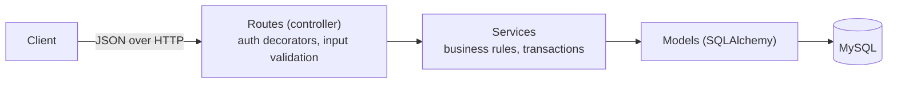
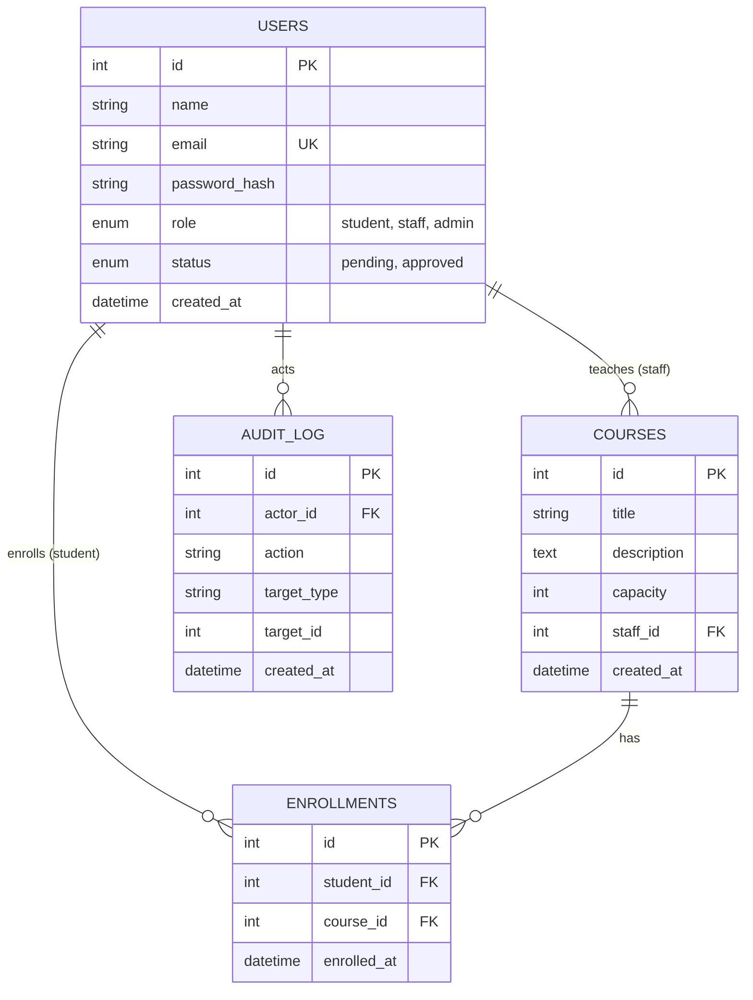
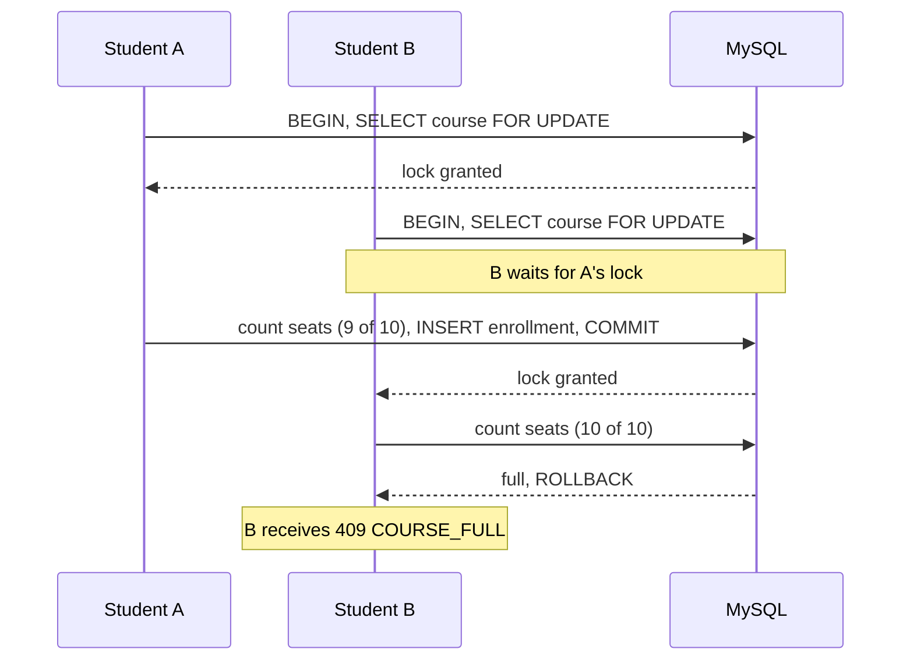

# Design

SkillBoost is a Flask API in three layers (routes, services, models) over MySQL; this design fixes the data model, endpoints, and the seat-locking flow before any code is written. Status: draft. Items marked (assumed) may change.

## Architecture

Calls go one way only: routes call services, services call models, models talk to MySQL. The diagram is a Mermaid block, so it renders on GitHub.



**What each layer may do**

- **Routes:** read the request, check the token and role, validate input, call one service function, return JSON. No queries here.
- **Services:** enforce rules such as "course is full" or "already enrolled", own the database transaction, and raise typed errors. They never touch Flask's `request`, so unit tests need no HTTP.
- **Models:** table definitions and relationships only.
- **Error handler:** one place that turns a typed error into the standard JSON error.

**Folder structure**

```
skillboost/
  app/
    __init__.py          # create_app(): blueprints, error handlers
    config.py            # settings read from environment variables
    extensions.py        # db, rate limiter
    models.py            # User, Course, Enrollment, AuditLog
    errors.py            # AppError + handler
    auth.py              # JWT helpers, token_required, role_required
    cli.py               # flask create-admin
    schemas.py           # input validation
    routes/              # auth, admin, courses, enrollments, health
    services/            # user_service, course_service, enrollment_service
  tests/
    unit/  integration/  e2e/  conftest.py
  scripts/seed.py
  docs/                  # overview.md, design.md, process.md
  .github/workflows/ci.yml
  Dockerfile  docker-compose.yml
  requirements.txt  .env.example  README.md
```

## Data model

Four tables: users, courses, enrollments, and an audit log. Seats taken are counted from enrollments rather than stored, so the count can never drift out of sync.



| Table | Constraints and indexes |
| --- | --- |
| users | UNIQUE email; role limited to student, staff, admin; status limited to pending, approved and defaults to pending |
| courses | FK staff\_id to users.id; capacity at least 1 (CHECK, enforced on MySQL 8.0.16 and later, plus input validation); index on staff\_id |
| enrollments | FK student\_id to users.id; FK course\_id to courses.id; UNIQUE (student\_id, course\_id) so a duplicate enroll is rejected by the database itself; index on course\_id |
| audit\_log | FK actor\_id to users.id; index on (target\_type, target\_id) |

**Rules to confirm**

- Deleting a course that has enrollments returns 409 (assumption; the alternative is cascading the delete).
- Schema changes go through one initial migration (Flask-Migrate), not a pile of them.

## API

Twelve endpoints, all JSON. Protected routes expect `Authorization: Bearer <token>`. A 401 means the caller is not authenticated (missing, invalid, or expired token, or wrong credentials); a 403 means the caller is authenticated but not allowed (wrong role, not the owner, or account still pending).

| Method | Path | Who | Success | Errors |
| --- | --- | --- | --- | --- |
| GET | /health | Public | 200 | none |
| POST | /auth/register | Public | 201 | 400, 409 |
| POST | /auth/login | Public | 200 with token | 400, 401, 403 (pending) |
| GET | /admin/pending | Admin | 200 | 401, 403 |
| POST | /admin/approve/\<id> | Admin | 200 | 401, 403, 404 |
| GET | /courses | Any approved user | 200, paginated | 401 |
| POST | /courses | Staff | 201 | 400, 401, 403 |
| PUT | /courses/\<id> | Staff, owner only | 200 | 400, 401, 403, 404 |
| DELETE | /courses/\<id> | Staff, owner only | 204 | 401, 403, 404, 409 (has enrollments) |
| POST | /enrollments | Student | 201 | 400, 401, 403, 404, 409 (already enrolled or full) |
| DELETE | /enrollments/\<course\_id> | Student | 204 | 401, 403, 404 |
| GET | /enrollments/me | Student | 200 | 401, 403 |

**Course list query:** `page` (default 1), `per_page` (default 20, max 100), `q` (title contains), `sort` (`title` or `created_at`, prefix `-` for descending).

**Login response:** `{"access_token": "...", "token_type": "Bearer", "expires_in": 3600}`. The token carries the user id, role, and expiry.

**Standard error format** (every error, every endpoint):

```json
{ "error": { "code": "COURSE_FULL", "message": "This course has no seats left." } }
```

Error codes: `VALIDATION_ERROR` (400), `UNAUTHORIZED` (401), `FORBIDDEN` (403), `NOT_FOUND` (404), `EMAIL_TAKEN`, `ALREADY_ENROLLED`, `COURSE_FULL`, `COURSE_HAS_ENROLLMENTS` (all 409).

## Capacity-safe enrollment

The enroll service locks the course row before it counts seats, so two students racing for the last seat are handled one at a time and only one succeeds.



**Service steps**

1. Start a transaction.
2. Load the course with `SELECT ... FOR UPDATE` (`with_for_update()` in SQLAlchemy). Not found returns 404.
3. If the student already has an enrollment for it, return 409 `ALREADY_ENROLLED`.
4. Count the course's enrollments. If the count is at or above `capacity`, return 409 `COURSE_FULL`.
5. Insert the enrollment and commit. The commit releases the lock.

**Why it holds**

- The count happens after the lock is held, never before. That order is the whole fix.
- The lock is on one course row, so enrollments in different courses do not block each other.
- The UNIQUE (student\_id, course\_id) constraint is a second safety net: if the same student races themselves, the database rejects the second insert and the service maps that error to 409.
- The duplicate check and seat count are locking reads too; under REPEATABLE READ a plain read would use a snapshot taken before the lock was granted.
**Proof (the concurrency test)**

Create a course with capacity 3. Fire 10 enroll requests from 10 different students at the same time, each on its own database connection. Assert exactly 3 return 201, 7 return 409, and the table holds exactly 3 rows. This test commits for real (it cannot use a rolled-back test transaction) and cleans up afterward. It must run on MySQL, because SQLite does not support this kind of row lock.

## Cross-cutting rules

These rules apply to every endpoint, so they are built once and reused. Values marked (assumed) are starting points you can change.

| Area | Rule |
| --- | --- |
| Auth | PyJWT with a secret from the environment. Claims: user id, role, expiry (1 hour). `token_required` loads the user from the token; `role_required("staff")` checks the role. Pending accounts cannot log in. |
| Passwords | Hashed with bcrypt, minimum 8 characters (assumed). The hash is never returned in any response. |
| Validation | Every request body is validated in `schemas.py` (Pydantic, assumed) before it reaches a service. Failure returns 400 `VALIDATION_ERROR` naming the bad fields. |
| Errors | Services raise a typed `AppError` (code, message, status). One handler returns the standard JSON. Unexpected exceptions return 500 `INTERNAL_ERROR` with no stack trace. |
| Logging | JSON logs with timestamp, level, request ID, user ID, method, path, status. The request ID comes from `X-Request-ID` or is generated, and is echoed in the response header. Passwords and tokens are never logged. |
| Rate limiting | Flask-Limiter on `/auth/login`, 5 per minute per IP (assumed). |
| CORS | Allowed origins come from the environment. |
| Config | Everything from environment variables (`DATABASE_URL`, `JWT_SECRET`, `CORS_ORIGINS`); `.env` stays out of git and `.env.example` lists the names. |
| Audit log | An admin approval writes an `audit_log` row (actor, action, target) in the same transaction as the approval. |

## Testing strategy

Each level catches a different kind of defect, so each user story gets tests at more than one level.

| Level | Folder | Runs against | Catches | Example here |
| --- | --- | --- | --- | --- |
| Unit | `tests/unit` | No database, no HTTP | Logic errors in small pieces | Expired token is rejected; password hash verifies |
| Integration | `tests/integration` | Flask test client + MySQL test database | Wiring bugs: missing commit, wrong 401 vs 403, constraints not enforced | Enroll twice returns 409 and exactly one row exists |
| Concurrency | `tests/integration` | MySQL, 10 threads | Race conditions | 10 students, 3 seats: 3 succeed, 7 get 409 |
| End-to-end | `tests/e2e` | Whole app, one full flow | Breaks between modules | Register, approve, login, create course, enroll, drop |
| Acceptance | across all folders | Each acceptance-criteria line | Building the wrong thing | `test_us6_enroll_full_course_returns_409` |

**Ground rules**

- Test names start with the story ID, so a failing test points to its story.
- Tests use a separate `skillboost_test` database, recreated per run. CI starts a throwaway MySQL service container.
- Coverage target is 80% (assumed), reported by CI.

## Decisions and trade-offs

Every choice below has a cost, and naming the cost is what makes the choice defensible in an interview.

| Decision | Reason | Trade-off |
| --- | --- | --- |
| Flask, not Django | Small API; you assemble auth, validation, and structure yourself and can explain each piece | More wiring by hand |
| SQLAlchemy ORM, not raw SQL | Models and relationships stay readable; schema changes are easier | Generated queries need watching (check with `EXPLAIN`) |
| Service layer | Business rules are testable without HTTP | More files for a small app |
| JWT access token only | Stateless and simple | A token cannot be revoked before it expires |
| Row lock on the course | Deterministic under contention; easy to prove with a test | Requests for the same course queue behind each other |
| Count enrollments, no `seats_taken` column | Count cannot drift from the real rows | One indexed COUNT per enroll; a counter updated under the same lock would be faster |
| Tests on MySQL, not SQLite | The row lock only exists on the real engine | Slower tests; needs a local MySQL (Docker Compose covers it) |
| Admin created by CLI | No path to become admin through the API | The first admin needs shell access |
